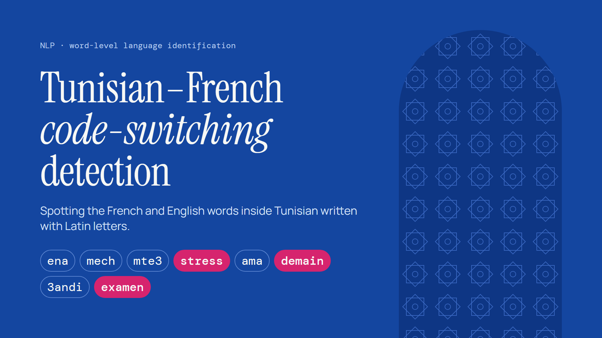
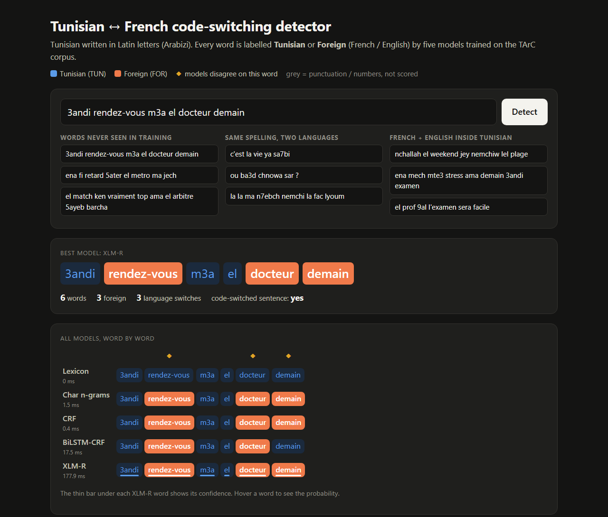

# Tunisian–French code-switching detection in Arabizi



Word-level language identification for **Tunisian Arabic written in Latin letters** (*Arabizi*). Each word is labelled **TUN** (Tunisian) or **FOR** (code-switched French or English).

```
la   la   ma   n7ebch  nemchi  la   fac  lyoum      "no, no, I don't want to go to uni today"
TUN  TUN  TUN  TUN     TUN     FOR  FOR  TUN
```

Both languages use the same alphabet, so the script gives no clue. A model has to rely on spelling (digits used as letters, like `3` = ع‎, `7` = ح‎, `9` = ق‎; French endings and accents) and on **context**. In the sentence above, the first two `la` mean Tunisian "no" and the third is the French article.

**Demo app** (`python scripts/demo_app.py`): five models label the same sentence side by side, with disagreements marked.



## Results

Test set: 347 sentences, 3,378 words. The data was split 80/10/10, duplicates were removed before splitting, and every hyper-parameter was chosen on dev.

| Model | Foreign-word F1 [95% CI] | Unseen words | Ambiguous words | Switch points |
|---|---|---|---|---|
| Majority (all TUN) | 0.000 | 0.44 | 0.38 | 0.00 |
| Lexicon lookup | 0.834 [0.808, 0.854] | 0.44 | 0.87 | 0.51 |
| Char n-gram + logistic regression | 0.946 [0.930, 0.959] | 0.94 | 0.85 | 0.78 |
| CRF (hand-crafted features + context) | 0.959 [0.947, 0.969] | 0.94 | 0.96 | 0.82 |
| BiLSTM-CRF (word + char CNN) | 0.966 [0.954, 0.975] | 0.95 | 0.97 | 0.84 |
| **XLM-RoBERTa base, fine-tuned** | **0.978 [0.968, 0.985]** | **0.97** | **0.98** | **0.90** |

- **Unseen words:** macro F1 on test words whose spelling never appears in training. That's 31% of the test set, because Arabizi has no standard spelling.
- **Ambiguous words:** macro F1 on test words seen with both labels in training (`la`, `ma`, `ou`, `en`, …).
- **Switch points:** F1 on the exact positions where the language changes.
- **Confidence intervals:** the 95% intervals come from 1,000 bootstrap resamples of test sentences.

**Main findings:**
- Character-level features fix unseen spellings.
- Context fixes ambiguous words. The context-free n-gram model is *worse* than the lexicon on ambiguous words.
- Multilingual pre-training gives the best overall model.
- Domain shift matters: trained without rap lyrics and tested on them, foreign-word F1 drops from about 0.95 to about 0.78.

The full write-up is in [docs/REPORT.md](docs/REPORT.md).

## Quick start

Python 3.10–3.12. A CUDA GPU is recommended for XLM-R; everything else runs on CPU in seconds or minutes.

```bash
python -m venv .venv
# Windows: .venv\Scripts\activate    Linux/macOS: source .venv/bin/activate
pip install -r requirements.txt      # for GPU training, install the CUDA build of torch first (pytorch.org)

python scripts/prepare_data.py       # clean + split TArC -> data/processed/
python scripts/train_evaluate.py     # train and evaluate all models -> models/, results/  (~8 min on an RTX 3050)
python scripts/train_evaluate.py --skip-xlmr   # without a GPU
python -m unittest discover -s tests
```

**Try the models:**

```bash
python scripts/demo.py "el film hedha vraiment 7lou barcha"   # command line
python scripts/demo_app.py                                    # local web app at http://127.0.0.1:8000
```

**Notebook:** [`notebooks/tunisian_french_codeswitch_detection.ipynb`](notebooks/tunisian_french_codeswitch_detection.ipynb) walks through the whole project: the raw data, descriptive statistics, cleaning, exploratory analysis, the five models, results, error analysis and the cross-genre test.
- It's committed with its outputs, so you can read it on GitHub without running anything.
- With `RETRAIN = False` (the default), it reloads the models in `models/` and trains any that are missing.

Trained models are not included in the repository (about 1.1 GB, mostly XLM-R). Run `scripts/train_evaluate.py` to create them.

## Project structure

```
├── data/
│   ├── raw/                 tarc.tsv (TArC corpus) + the corpus authors' README
│   └── processed/           train / dev / test splits (JSONL) + summary.json
├── notebooks/               main walkthrough notebook (executed)
├── src/tuncs/               Python package
│   ├── data.py              loading, cleaning, normalisation, splitting
│   ├── metrics.py           token, unseen, ambiguous, sentence and switch-point metrics; bootstrap CI
│   ├── experiment.py        train-or-load, scoring, result tables and plots
│   └── models/              lexicon, char n-gram LogReg, CRF, BiLSTM-CRF, XLM-R (shared fit/predict/save/load API)
├── scripts/                 prepare_data, train_evaluate, demo (CLI), demo_app (web)
├── app/index.html           demo web page (no external dependencies)
├── results/                 figures, tables and per-model test predictions
├── docs/                    REPORT.md (write-up), DEMO_GUIDE.md (demo walkthrough)
└── tests/                   unit tests for cleaning and metrics
```

## Method in brief

- **Cleaning:** these tokens are dropped:
  - emojis;
  - tokens without letters (punctuation, numbers);
  - anonymised user names.

  Words are lower-cased and letters repeated 3+ times are squeezed (`loooool` → `lool`). Digits and accents are kept, because they are the main clues.
- **Models:**
  1. a lexicon lookup;
  2. TF-IDF character 1–5-grams with logistic regression (balanced class weights);
  3. a linear-chain CRF with features of each word and two neighbours on each side;
  4. a BiLSTM-CRF with word embeddings, a character CNN and 10% word dropout;
  5. fine-tuned `xlm-roberta-base` (first sub-word labelling, FP16, best dev epoch).
- **Evaluation:** the main metric is foreign-word F1, because accuracy is misleading when 70% of words are Tunisian.

## Limitations

- One random split and one training seed per model. The confidence intervals reflect test-set sampling, not training variance.
- The data split and the lexicon, n-gram and CRF results reproduce exactly. The neural models (BiLSTM-CRF, XLM-R) can differ slightly between runs because GPU training is non-deterministic: one retrain of the BiLSTM-CRF gave 0.964 instead of 0.966 foreign-word F1.
- The corpus labels French and English together as "foreign", and puts Modern Standard Arabic inside the Tunisian class.
- TArC has no author IDs, so posts by the same person may appear in both train and test.
- The results are not directly comparable with the corpus authors' reported classifier accuracy, which was measured on a different split.

## Data and licence

- **Data:** TArC, the Tunisian Arabish Corpus. E. Gugliotta and M. Dinarelli, *TArC: Tunisian Arabish Corpus, First complete release*, LREC 2022, <https://github.com/eligugliotta/tarc>. `data/raw/tarc.tsv` is redistributed unchanged under its original **CC BY-NC-SA 4.0** licence; the files in `data/processed/` are derived from it under the same licence.
- **Code:** MIT, see [LICENSE](LICENSE). The MIT licence applies to the code only, not to the data.

If you use the data, please cite the TArC paper:

```bibtex
@inproceedings{gugliotta-dinarelli-2022-tarc,
  title     = {{TArC}: Tunisian Arabish Corpus, First complete release},
  author    = {Gugliotta, Elisa and Dinarelli, Marco},
  booktitle = {Proceedings of the Thirteenth Language Resources and Evaluation Conference},
  year      = {2022},
  pages     = {1125--1136}
}
```
